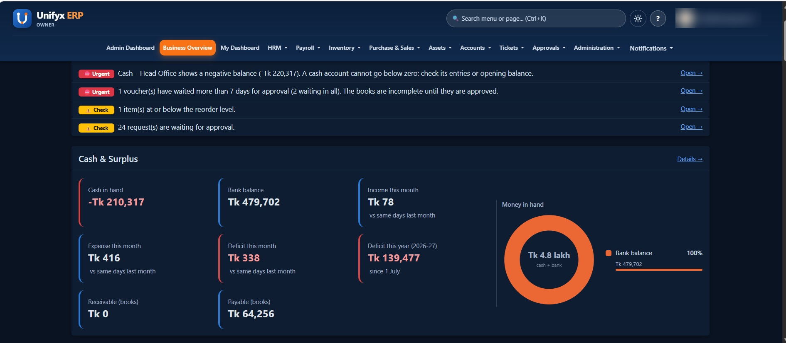
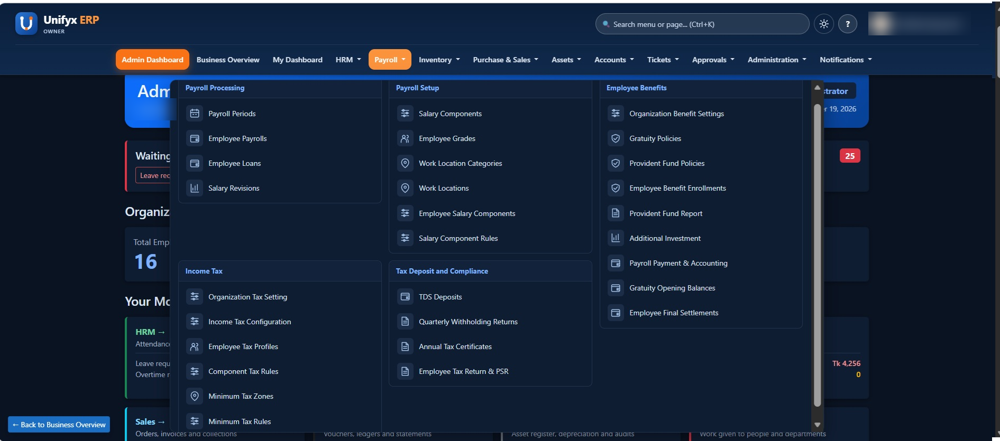
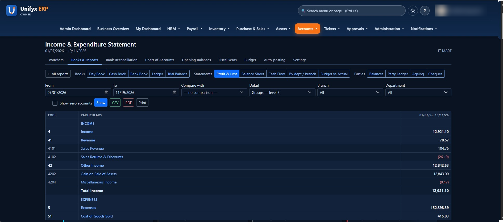
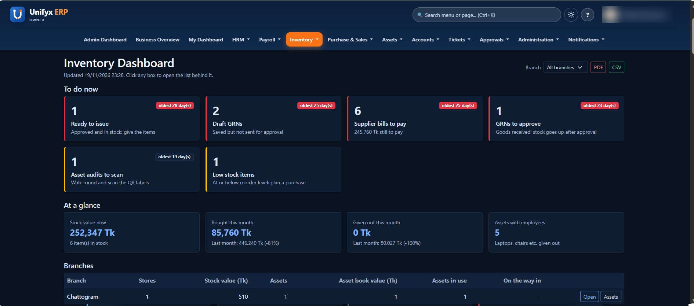
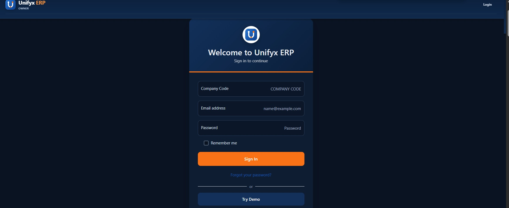

# Unifyx ERP — Company Website

The public marketing website for **Unifyx ERP**, an HR, payroll, inventory and accounts system built for businesses in Bangladesh.

**Live site:** https://unifyxerp.com  ·  **Try the ERP (demo):** https://app.unifyxerp.com → *Try Demo*


> This repository contains only the website. The ERP application itself is kept in a private repository.

---

## The ERP behind the website

Unifyx ERP is a multi-company (one database per company) ASP.NET Core MVC application with HR, payroll and Bangladesh income tax, inventory, purchase & sales with VAT, fixed assets, double-entry accounts, tickets and approvals. Anyone can try it with sample data at **https://app.unifyxerp.com → Try Demo**.

| **Business Overview** | **Payroll menu** |
|---|---|
|  |  |
| **Accounts reports** | **Inventory stock** |
|  |  |
| **Login with Try Demo** | |
|  | |

---

## Features

**Public site**
- **Bilingual — English and Bangla** (`/en/...`, `/bn/...`), with the visitor's language remembered and `hreflang` links for search engines
- **Day / night theme** (night by default), remembered per visitor
- Home page with modules, features, "who it's for", pricing, news, FAQ and team sections
- **Products menu** and module pages managed from the admin panel
- **Request-a-demo form** with rate limiting; optional e-mail alert to the owner
- Floating **WhatsApp** button and social links
- Responsive layout for phone, tablet and laptop, including laptops running at 125–175 % Windows scaling

**SEO**
- Generated `sitemap.xml` (both languages, products and news) and `robots.txt`
- Canonical URLs, Open Graph / Twitter cards and JSON-LD (`Organization`, `SoftwareApplication`)

**Admin panel** (`/admin`, ASP.NET Core Identity login)
- Edit every text on the site in both languages, without a deploy
- Manage home sections, modules, products, news, FAQs, team members and pop-up notices
- Upload images, set contact details (phone, WhatsApp, e-mail, social links)
- View demo requests and a **visitor counter** (visitors, first-time visitors and page views per day — no IP addresses stored)

## Tech stack

| Part | Technology |
|---|---|
| Framework | ASP.NET Core **.NET 10**, Razor Pages |
| Data | Entity Framework Core 10, SQL Server |
| Auth | ASP.NET Core Identity (admin only) |
| Front end | Hand-written CSS and vanilla JavaScript (no UI framework) |
| Hosting | IIS on Windows, published to the internet through Cloudflare Tunnel |

## Project structure

```
UnifyxWeb/
├── Pages/               Razor Pages (public site + Admin/)
├── Data/                SiteDbContext, models, first-run seeding
├── Migrations/          EF Core migrations
├── wwwroot/             CSS, JavaScript, logos (uploads/ is created at run time)
├── Seo.cs               sitemap.xml and robots.txt endpoints
├── VisitCounter.cs      privacy-friendly visit counting
├── DemoMailer.cs        e-mail alert for demo requests
├── SiteTextDefaults.cs  default English / Bangla texts
└── Program.cs
```

## Run it locally

Requirements: **.NET 10 SDK** and **SQL Server** (Express or LocalDB).

1. Clone the repository and open `UnifyxWeb/UnifyxWeb.csproj` in Visual Studio (or use the `dotnet` CLI).
2. Check the connection string `SiteConnection` in `UnifyxWeb/appsettings.json`. It points to `.\SQLEXPRESS`; for LocalDB use `Server=(localdb)\MSSQLLocalDB`.
3. Create the first admin account with user secrets (never in code or `appsettings.json`):
   ```bash
   cd UnifyxWeb
   dotnet user-secrets set "AdminSeed:Email" "you@example.com"
   dotnet user-secrets set "AdminSeed:Password" "<a strong password>"
   ```
4. Run:
   ```bash
   dotnet run
   ```
   The database is created and migrated on first start. Open `https://localhost:7101`; the admin panel is at `/admin`.

**Optional — e-mail alerts for demo requests:** fill `Smtp` in `appsettings.json` (host, port, user, from, notify-to) and keep the password in user secrets:
```bash
dotnet user-secrets set "Smtp:Password" "<smtp password>"
```

## Author

**Mahedi Hasan Prodhan** — [LinkedIn](https://www.linkedin.com/in/mahedi-hasan-prodhan) · [GitHub](https://github.com/mahedibd6-max)

## License

© 2026 Unifyx. All rights reserved. The code is published so it can be read and reviewed; please ask before reusing it.
